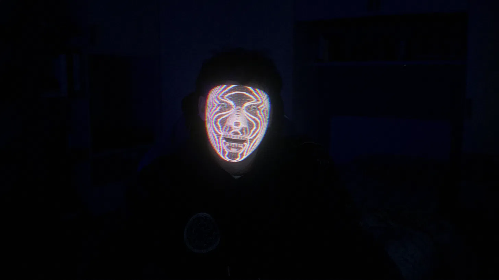

# Maschera — real-time holographic face mask

A Python webcam filter that tracks your face with [MediaPipe](https://ai.google.dev/edge/mediapipe) and draws a glowing, sci-fi "hologram" over it: topographic contour lines, particles, trails, bloom and glitch effects. Newer versions render on the GPU with OpenGL. They react to your expressions and voice, and can send the result to a virtual webcam for OBS, Zoom, Discord and similar apps.

> The code, comments and on-screen messages are in Italian.

<p align="center">
  
  
</p>

## Features

- **Face tracking**: 478-point face mesh from MediaPipe Face Landmarker, plus Pose Landmarker to attach the wings to your shoulders
- **GPU rendering** (v5+): a 3D face mesh with per-pixel contour lines. Particles, trails, bloom and glitch are all shaders (moderngl + glfw).
- **Styles**: hologram, dots only, lines only
- **Line patterns**: depth contours, rings around the eyes and mouth, or scanlines
- **Add-ons**: irises, teeth, facial features, horns, ASCII demon wings
- **Color presets**: cyan, alarm red, gold, black & white, plus hue/saturation controls and the system color picker
- **Reactions**:
  - your voice sends a wave of light out from the mouth with each syllable
  - frowning turns the mask red and makes it shake
  - surprise (wide eyes) gives a white flash
  - winking triggers a short glitch
  - raised eyebrows make the lines scroll faster
  - when you enter or leave the frame, the face materializes or dissolves outward from the nose
- **Slider panel** (TAB) for line count, glow, trail, perspective, size, color and more. Settings are saved to `maschera_impostazioni.json` on exit and reloaded on start. Delete the file to reset them.
- **Capture**: PNG screenshots and MP4 recording
- **Virtual webcam** output via `pyvirtualcam`

## Requirements

- Python 3.10+ (developed with 3.12)
- A webcam
- A GPU with OpenGL 3.3+ (GPU versions only)

```bash
python -m venv .venv
# Windows
.venv\Scripts\activate
# macOS / Linux
source .venv/bin/activate

pip install -r requirements.txt
```

`sounddevice` (voice reaction) and `pyvirtualcam` (virtual webcam) are optional. Each script also lists its own dependencies at the top.

Prefer not to clone the whole repo? Each version can also be downloaded on its own as a zip from the [Releases](https://github.com/k0m1d3v/maschera/releases) page.

The MediaPipe models are downloaded automatically the first time you run a script. v14 and v15 keep them in `models/`.

## Usage

```bash
python v14_fast_geometry.py              # normal window
python v14_fast_geometry.py --virtuale   # also send the output to a virtual webcam
```

The virtual webcam needs OBS installed on Windows and macOS, or the `v4l2loopback` module on Linux.

### Controls (latest version)

| Key | Action |
|---|---|
| `TAB` | Slider panel |
| `1`–`4` | Presets: cyan, alarm red, gold, black & white |
| `l` | Line pattern: contours / eye & mouth rings / scan |
| `m` | Style: hologram / dots only / lines only |
| `z` | Centered, zoomed face in perspective ↔ real position |
| `o` / `d` / `t` | Irises / teeth / features (eyebrows, eyes, lips) |
| `k` | Horns |
| `a` | ASCII demon wings |
| `g` | Glitch |
| `b` | Black background ↔ dimmed webcam |
| `p` | System color picker |
| `←` / `→` | Hue |
| `↑` / `↓` | Saturation |
| `f` | Fullscreen |
| `s` | Save a screenshot (PNG) |
| `r` | Start/stop video recording (MP4) |
| `q` / `Esc` | Quit |

Screenshots and recordings are saved in `captures/` as `maschera_YYYYMMDD_HHMMSS.png` / `.mp4`.

## Versions

Each file is a standalone snapshot of the project at one stage. The two current versions are in the main folder; older ones are in `versions/`. Most recent last:

| File | What it adds |
|---|---|
| `versions/v01_prototype.py` | First prototype: CPU, dots and contour lines (OpenCV) |
| `versions/v02_expressions.py` | Glitch, expression reactions (open mouth, smile, eyebrows) |
| `versions/v03_silhouette_virtualcam.py` | Hair/silhouette segmentation, virtual webcam |
| `versions/v04_gpu.py` | GPU rendering (moderngl + glfw), zoom, irises, teeth, color picker |
| `versions/v05_presets_voice.py` | Presets, line patterns, voice reaction, new expressions, screenshots & recording |
| `versions/v06_slider_panel.py` | Slider panel, persistent settings |
| `versions/v07_slider_panel_fix.py` | Fixes to the slider panel; drops the full-head toggle |
| `versions/v08_horns.py` | Horns |
| `versions/v09_ascii_wings.py` | ASCII demon wings |
| `versions/v10_wings_refined.py` | Refinements to the wings and overall look |
| `versions/v11_body_outline.py` | Body outline from the neck down (Pose Landmarker): a glowing profile with a few contour lines |
| `versions/v12_no_body_outline.py` | Removes the body outline. Pose tracking is kept only for the wings. Fixes the dark square under the chin. |
| `versions/v13_optimized.py` | Faster tracking: MediaPipe runs on a 640 px copy, the camera is read on its own thread (MJPG), the body is tracked every other frame. Faster mesh math, and the virtual webcam is capped at 30 fps. Asks the webcam for 60 fps. |
| `v14_fast_geometry.py` | Rewritten mesh geometry code, about 25% less CPU per frame with an identical image. **Recommended.** |
| `v15_lite.py` | v14 for weaker PCs (integrated graphics, older laptops): no 2× supersampling and 4 bloom levels instead of 6. Slightly harder edges and a narrower glow. |

## How it works

1. A background thread reads the webcam and runs MediaPipe face (and pose) tracking on the CPU.
2. The main thread renders with OpenGL at the display's refresh rate. The face mesh is drawn in 3D, and contour lines are computed per pixel from depth. Particles, trails, bloom and glitch run as shader passes.
3. The final frame is shown in a window and can also be pushed to a virtual camera, saved as PNG or recorded to MP4.

## Project layout

```
README.md, requirements.txt
v14_fast_geometry.py   recommended version
v15_lite.py            lighter version for weaker PCs
versions/              earlier versions (v01–v13)
docs/                  images for this README
models/                MediaPipe models, downloaded on first run (not in git)
captures/              your screenshots and recordings (not in git)
```
