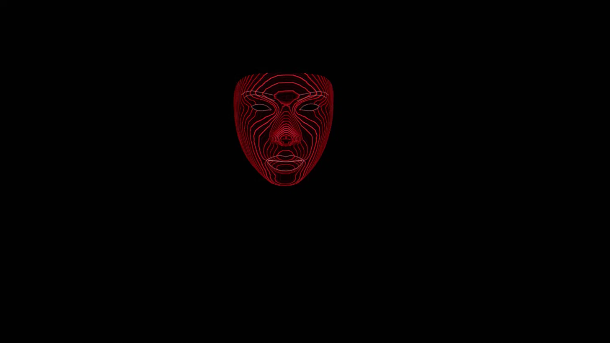

# Maschera — real-time holographic face mask

A Python webcam filter that tracks your face with [MediaPipe](https://ai.google.dev/edge/mediapipe) and draws a glowing, sci-fi "hologram" over it: topographic contour lines, particles, trails, bloom and glitch effects. Newer versions render on the GPU with OpenGL. They react to your expressions and voice, and can send the result to a virtual webcam for OBS, Zoom, Discord and similar apps.

> The code, comments and on-screen messages are in Italian.

<p align="center">
  
  
</p>

## Features

- **Face tracking**: 478-point face mesh from MediaPipe Face Landmarker, plus Pose Landmarker for the body in later versions
- **GPU rendering** (v5+): a 3D face mesh with per-pixel contour lines. Particles, trails, bloom and glitch are all shaders (moderngl + glfw).
- **Styles**: hologram, dots only, lines only
- **Line patterns**: depth contours, rings around the eyes and mouth, or scanlines
- **Add-ons**: irises, teeth, facial features, horns, ASCII demon wings, a body outline from the neck down
- **Color presets**: cyan, alarm red, gold, black & white, plus hue/saturation controls and the system color picker
- **Reactions**:
  - your voice sends a wave of light out from the mouth with each syllable
  - frowning turns the mask red and makes it shake
  - surprise (wide eyes) gives a white flash
  - winking triggers a short glitch
  - raised eyebrows make the lines scroll faster
  - when you enter or leave the frame, the face materializes or dissolves outward from the nose
- **Slider panel** (TAB) for line count, glow, trail, perspective, size, color and more. Settings are saved to `maschera_impostazioni.json` on exit and reloaded on start. Delete the file to reset them.
- **Capture**: PNG screenshots and MP4 recording
- **Virtual webcam** output via `pyvirtualcam`

## Requirements

- Python 3.10+ (developed with 3.12)
- A webcam
- A GPU with OpenGL 3.3+ (GPU versions only)

```bash
python -m venv .venv
# Windows
.venv\Scripts\activate
# macOS / Linux
source .venv/bin/activate

pip install mediapipe opencv-python numpy moderngl glfw
pip install sounddevice    # optional: voice reaction
pip install pyvirtualcam   # optional: virtual webcam output
```

The MediaPipe models (`face_landmarker.task`, `pose_landmarker_lite.task`, `selfie_multiclass_256x256.tflite`) are downloaded automatically the first time you run a script.

## Usage

```bash
python "AddT-shirt.py"              # normal window
python "AddT-shirt.py" --virtuale   # also send the output to a virtual webcam
```

The virtual webcam needs OBS installed on Windows and macOS, or the `v4l2loopback` module on Linux.

### Controls (latest version)

| Key | Action |
|---|---|
| `TAB` | Slider panel |
| `1`–`4` | Presets: cyan, alarm red, gold, black & white |
| `l` | Line pattern: contours / eye & mouth rings / scan |
| `m` | Style: hologram / dots only / lines only |
| `z` | Centered, zoomed face in perspective ↔ real position |
| `o` / `d` / `t` | Irises / teeth / features (eyebrows, eyes, lips) |
| `k` | Horns |
| `a` | ASCII demon wings |
| `y` | Body outline from the neck down |
| `g` | Glitch |
| `b` | Black background ↔ dimmed webcam |
| `p` | System color picker |
| `←` / `→` | Hue |
| `↑` / `↓` | Saturation |
| `f` | Fullscreen |
| `s` | Save a screenshot (PNG) |
| `r` | Start/stop video recording (MP4) |
| `q` / `Esc` | Quit |

Screenshots and recordings are saved in the working directory as `maschera_YYYYMMDD_HHMMSS.png` / `.mp4`.

## Versions

Each file is a standalone snapshot of the project at one stage. Most recent last:

| File | What it adds |
|---|---|
| `maschera.py` | First prototype: CPU, dots and contour lines (OpenCV) |
| `Ologramma.py` | Glitch, expression reactions (open mouth, smile, eyebrows) |
| `Ologramma V.2.py` | Hair/silhouette segmentation, virtual webcam |
| `Ologramma V.3.py` | GPU rendering (moderngl + glfw), zoom, irises, teeth, color picker |
| `Ologramma V.4.py` | Presets, line patterns, voice reaction, new expressions, screenshots & recording |
| `Ologramma V.5.py` / `V.5 fix.py` | Slider panel, persistent settings |
| `Ologramma V.6.py` | Horns |
| `isThisNewArt.py` | ASCII demon wings |
| `isThisArt.py` | v8 refinements |
| `JumpInHistory.py` | Samurai armor (yoroi) from the neck down, using Pose Landmarker |
| `AddT-shirt.py` | Body outline in place of the armor: a glowing profile with a few contour lines |

## How it works

1. A background thread reads the webcam and runs MediaPipe face (and pose) tracking on the CPU.
2. The main thread renders with OpenGL at the display's refresh rate. The face mesh is drawn in 3D, and contour lines are computed per pixel from depth. Particles, trails, bloom and glitch run as shader passes.
3. The final frame is shown in a window and can also be pushed to a virtual camera, saved as PNG or recorded to MP4.
